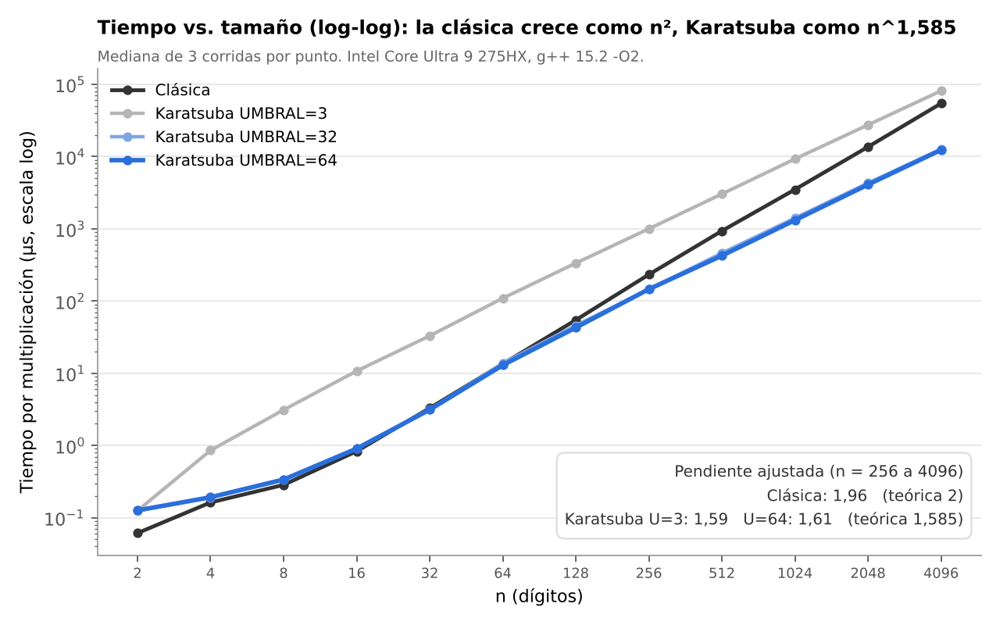
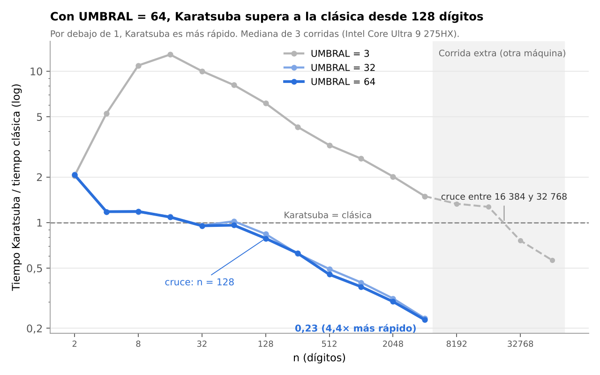

# Práctica 2: Multiplicación rápida de enteros (Algoritmo de Karatsuba)

Análisis y Diseño de Algoritmos. Divide y Vencerás: recurrencias y Teorema Maestro.

Implementación en C++ de la multiplicación clásica Θ(n²) y del algoritmo de
Karatsuba Θ(n^log2(3)) sobre números representados como cadenas de dígitos
en base 10, con validación de correctitud y medición de tiempos.

## Integrantes

- Santiago Díaz Quintero
- Juan Diego Martínez Jaramillo
- Samuel Molina Garcés

## Estructura del proyecto

```
ADA_P2_Diaz_Martinez_Molina/
├── Makefile
├── README.md
├── .gitignore
├── src/
│   ├── operaciones.h / operaciones.cpp   # sumar, restar, desplazar, partir, normalizar, rellenar
│   ├── algoritmos.h  / algoritmos.cpp    # multiplicacionClasica, karatsuba y UMBRAL
│   └── main.cpp                          # menú, validación y medición de tiempos
├── resultados/
│   ├── tabla_umbral{3,32,64}_corrida{1,2,3}.txt   # generados por la opción 2
│   └── Karatsuba_tiempos.xlsx            # medianas, razones y gráfica log-log
└── informe/
    ├── informe.pdf                       # informe de la práctica
    ├── grafica_tiempos.png               # tiempo vs. tamaño (log-log)
    └── grafica_cociente.png              # Karatsuba / clásica y punto de cruce
```

## Requisitos

- Compilador `g++` con soporte de C++17 o superior
- `make`

En Ubuntu o Debian se instalan con:

```bash
sudo apt update
sudo apt install build-essential
```

Para verificar:

```bash
g++ --version
make --version
```

## Compilación

Desde la carpeta raíz del proyecto (donde está el `Makefile`):

```bash
make
```

Esto genera el ejecutable `karatsuba`.

Si no tienes `make`, puedes compilar directamente con:

```bash
g++ -std=c++17 -O2 -Wall -o karatsuba src/main.cpp src/algoritmos.cpp src/operaciones.cpp
```

Para borrar los archivos generados:

```bash
make clean
```

## Ejecución

```bash
./karatsuba
```

Se abre un menú por consola:

```
=== MENU PRINCIPAL ===
0. Salir
1. Validar correctitud
2. Medir tiempos
```

### Opción 1: Validar correctitud

Primero verifica la clásica contra dos valores conocidos. Luego compara la
salida de `karatsuba` contra `multiplicacionClasica` dos veces, con
`UMBRAL = 3` (para que hasta los casos pequeños pasen por la recursión) y con
`UMBRAL = 64` (la configuración de la medición), e imprime `OK` o `FALLO` por
cada caso. Los casos cubiertos son:

- Números de 1 dígito
- Acarreos (99 x 99) y multiplicación por cero
- Ceros a la izquierda
- Ceros intercalados y potencias de 10
- Longitudes impares y longitudes distintas entre los operandos
- Productos aleatorios grandes (300 y 517 x 333 dígitos)

Al final muestra `Todos los casos pasaron.` si no hubo errores.

### Opción 2: Medir tiempos

Ejecuta en una sola corrida del programa 3 mediciones por cada valor de
`UMBRAL` (3, 32 y 64). Para cada una recorre n = 2, 4, 8, ..., 4096, muestra
la tabla en consola y la guarda automáticamente en
`resultados/tabla_umbral{U}_corrida{C}.txt` (9 archivos en total):

```
n    clasica_us    karatsuba_us
```

Para reproducir todos los resultados sin usar el menú:

```bash
printf '2\n0\n' | ./karatsuba
```

Protocolo de medición:

- Reloj: `std::chrono::steady_clock`
- Entradas aleatorias generadas fuera del cronómetro, con semilla
  `srand(42 + c)`: la corrida c usa los mismos operandos en los tres umbrales
- Cada multiplicación se repite hasta acumular al menos 10 ms y se reporta
  el promedio por ejecución (en microsegundos)
- Una llamada de calentamiento previa, que no se cronometra
- El resultado se consume en un acumulador (`fantasma`) para que el
  compilador no elimine el cálculo con `-O2`

Los tiempos absolutos dependen de la máquina. Para comparar resultados,
compilar siempre con `-O2` (ya incluido en el `Makefile`) y cerrar otros
programas pesados durante la medición.

## Equipo de medición y resultados

| | |
|---|---|
| Equipo | Lenovo Legion, Intel Core Ultra 9 275HX |
| Sistema operativo | Ubuntu 26.04 LTS |
| Compilador | g++ (Ubuntu 15.2.0-16ubuntu1) 15.2.0 |
| Banderas | `-std=c++17 -O2 -Wall` |

La opción 2 hace 3 corridas con cada valor de `UMBRAL` (3, 32 y 64); se
reporta la mediana (ver `resultados/Karatsuba_tiempos.xlsx`). Resumen:

- Con `UMBRAL = 64`, Karatsuba supera al clásico desde **n = 128** dígitos y en
  n = 4096 es unas 4,4 veces más rápido (12,4 ms frente a 54,4 ms).
- Con `UMBRAL = 32` el cruce también aparece en n = 128 y en n = 4096 tarda
  12,7 ms (≈ 4,3 veces más rápido que la clásica).
- Con `UMBRAL = 3` (Karatsuba puro) el cruce **no aparece** entre 2 y 4096
  dígitos, por el costo de las copias y reservas de memoria de cada llamada.
- Al duplicar n, el clásico tarda ~4 veces más (Θ(n²)) y Karatsuba ~3 veces
  más (Θ(n^log2(3))). Las pendientes en escala log-log entre n = 256 y 4096
  son 1,96 para la clásica y 1,59 para Karatsuba con `UMBRAL = 3`.





El análisis completo está en [`informe/informe.pdf`](informe/informe.pdf).

## Decisiones de diseño

- Representación: `std::string` de dígitos '0'-'9', dígito más significativo
  a la izquierda.
- `karatsuba(A, B)` acepta cualquier longitud. Normaliza, rellena a potencia
  de 2 una sola vez y delega en una función recursiva interna.
- La recursión iguala las longitudes entre sí sin redondear a potencia de 2,
  porque `x1 + x0` puede tener un dígito más.
- Caso base: n <= UMBRAL (variable global, 64 por defecto; mínimo 3), resuelto
  con la multiplicación clásica. Con n = 2 o n = 3, x1 + x0 puede tener n
  dígitos (9 + 9 = 18, 9 + 99 = 108), así que P3 no se achica y la recursión
  no terminaría. Desde n = 4, x1 + x0 tiene a lo sumo m + 1 < n dígitos.
- Orden de la resta: `(P3 - P1) - P2`, para que ningún resultado
  intermedio sea negativo.

## Declaración de uso de IA

Usamos Claude (Anthropic) como apoyo para entender el funcionamiento del
código y corregir errores, y también como apoyo en la organización de la tabla
y las gráficas de tiempos y en la redacción del informe. El equipo revisó todo
el código y el informe, y cada integrante puede explicarlos. La misma declaración está al final del informe.
